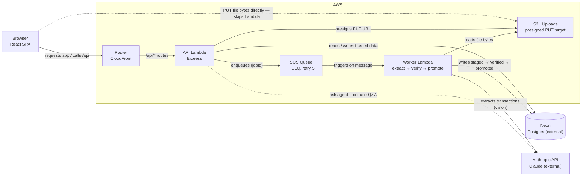

# Personal Finance Statement Auditor

Upload messy financial documents — PDF statements, receipts, CSV/XLSX exports — and get back
structured, categorized transactions that have actually been checked before you have to trust
them. LLM extraction is treated as a proposal, never as ground truth: a deterministic
verification layer gates everything before it reaches the data you browse.

**Live demo:** https://d1vaxwummjgz8i.cloudfront.net

## Why this exists

An average person tracking personal spending isn't an accountant, and won't open a finance app
more than a few times a month. The payoff has to be immediate: a trustworthy categorized view,
plus something they didn't already know (a duplicate charge, an unusual purchase, a straight
answer to "why was this month expensive?"). That framing drove most of the scope decisions in
this project — see [Product thinking](#product-thinking) below.

## Architecture



One CloudFront distribution serves both the built frontend and `/api/*`, so the app and API are
same-origin even without a custom domain — session cookies stay simple (`SameSite=Lax`), and
there's no CORS circular dependency to solve. The one hop worth noticing: uploaded file bytes go
straight from the browser to S3 via a presigned URL and never touch a Lambda function at all.

Local dev swaps three pieces without touching application code — that's the point of the
`StorageAdapter` interface and the shared job-processing functions:

| Concern | Production (AWS) | Local dev |
|---|---|---|
| File storage | `S3StorageAdapter`, presigned upload | `LocalDiskStorageAdapter`, multipart through Express |
| Job trigger | SQS → `worker.lambda.ts` | DB poll loop (`worker.ts`, `FOR UPDATE SKIP LOCKED`) |
| Database | Neon (serverless) | Homebrew Postgres 16 on localhost |

### The pipeline

Every document goes through the same four stages, run by whichever worker is active:

1. **Extract** — Claude vision (tool-use, JSON schema generated directly from a Zod schema) for
   PDF/image documents; deterministic parsing (papaparse / xlsx) with heuristic header-mapping
   for CSV/XLSX, falling back to an LLM only to decide *which column is which*, never to read
   the actual values.
2. **Validate** — every candidate row is checked against the shared Zod schema individually. A
   malformed row is dropped and logged; it never takes the rest of the batch down with it. This
   is the trust boundary: nothing reaches the staging table unvalidated.
3. **Verify** — six deterministic, zero-AI checks (`schema_valid`, `completeness`,
   `totals_reconcile`, `date_range_sanity`, `duplicate_within_document`,
   `duplicate_across_documents`) decide accept-vs-review. Warnings never block promotion; only
   blocking checks do.
4. **Promote** — if every blocking check passed, staged rows copy into the trusted `transactions`
   table automatically. Otherwise the document parks in `needs_review` for a human to correct
   and re-check, accept anyway, or reject — in the UI.

## Features

**Core (MVP):**
- Ingestion of PDF, image, CSV, and XLSX documents, processed asynchronously with live status
- Deterministic verification layer (see above) — the actual point of the project
- Review UI for flagged documents: what was extracted, which check failed and why, inline
  correction, accept/reject
- Transaction list with category/date-range filtering and running totals

**Bonus:**
- Spending-over-time chart, with a colorblind-safe categorical palette (validated, not eyeballed)
- Outlier flagging — transactions well above their own category's median, not one global
  threshold, and categories without enough history are skipped rather than flagged against noise
- AI Q&A — a bounded tool-use agent loop (not one call dressed up as an agent) grounded entirely
  in the trusted `transactions` table

## Tech stack

- **Backend:** Express (wrapped for Lambda via `@codegenie/serverless-express`), Drizzle ORM,
  Zod, Anthropic SDK
- **Frontend:** React, Vite, TanStack Query + TanStack Table, React Router, Recharts
- **Infra:** [SST](https://sst.dev) (AWS Lambda, S3, SQS, CloudFront), Neon (Postgres)
- **Testing:** Vitest — concentrated on the deterministic verification/outlier logic (25 tests),
  plus a small evals harness (`apps/api/src/evals`) scoring real extraction accuracy against
  hand-labeled fixtures

## Project structure

```
apps/
  api/     Express API + background worker (local poll loop + Lambda handlers)
  web/     React SPA (Vite)
packages/
  shared/  Zod schemas & types shared between api and web
sst.config.ts   AWS infrastructure (Lambda, S3, SQS, CloudFront) as code
```

## Running locally

Requires Node 20+, pnpm, and a local Postgres instance.

```bash
pnpm install

# Postgres (if not already running)
brew services start postgresql@16
createdb pfsa   # first time only

cp apps/api/.env.example apps/api/.env
# fill in DATABASE_URL and ANTHROPIC_API_KEY in apps/api/.env

pnpm --filter @pfsa/api db:migrate
```

Then, in three separate terminals:

```bash
pnpm --filter @pfsa/api dev          # API server, localhost:3001
pnpm --filter @pfsa/api dev:worker   # background worker — uploads won't process without this
pnpm --filter @pfsa/web dev          # frontend, localhost:5173
```

### Tests & evals

```bash
pnpm --filter @pfsa/api test   # unit tests (verification checks, outlier detection)
pnpm --filter @pfsa/api eval   # extraction accuracy against labeled fixtures — makes real
                                # Anthropic API calls, costs a few cents per run
```

## Deployment

Infrastructure is defined in `sst.config.ts` ([SST](https://sst.dev)). Requires AWS credentials
configured locally and two secrets set once per stage:

```bash
npx sst secret set DatabaseUrl "postgresql://..." --stage production
npx sst secret set AnthropicApiKey "sk-ant-..." --stage production
npx sst deploy --stage production
```

Database (Neon) is external and not provisioned by SST — run the migration against it once,
manually, before the first deploy:

```bash
DATABASE_URL="postgresql://..." pnpm --filter @pfsa/api db:migrate
```

## Product thinking

A few scope decisions, and why:

- **Recurring-charge detection and learning-from-corrections were cut.** Both need transaction
  *volume* to be useful, which a new account genuinely won't have.
- **Realtime push (SSE/websockets) was cut in favor of polling.** A personal app processing a
  handful of documents at a time doesn't need push infrastructure; the frontend only polls while
  a document is actually in flight, and stops the moment nothing is.
- **Multi-currency, budgets/goals, tax categorization, and multi-tenant sharing are out of scope
  entirely** — not what this kind of app is for.
- **A receipt and a bank-statement line describing the same purchase never silently drops
  either one.** `duplicate_across_documents` flags the pair as a warning and lets a human decide
  in the review UI — the deterministic layer isn't trusted to make that call on its own.

## Known limitations

- No CSRF token or login rate-limiting yet — worth addressing now that this is a public URL.
- The CSV single-amount-column path assumes a negative value means a debit; not universal.
- `jobs.stage` is a vestigial column — the pipeline doesn't yet resume mid-stage after a crash,
  it re-runs idempotently from the top instead.
- No pagination on document/transaction lists — fine at personal-project scale, a real
  limitation past a few hundred rows.
